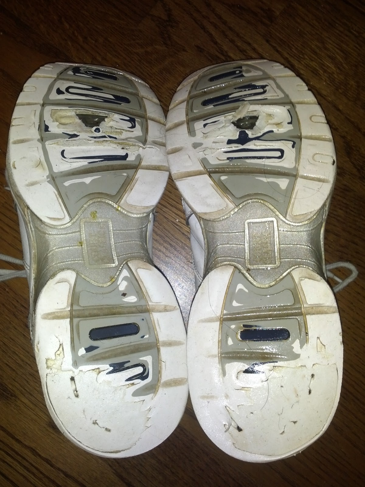
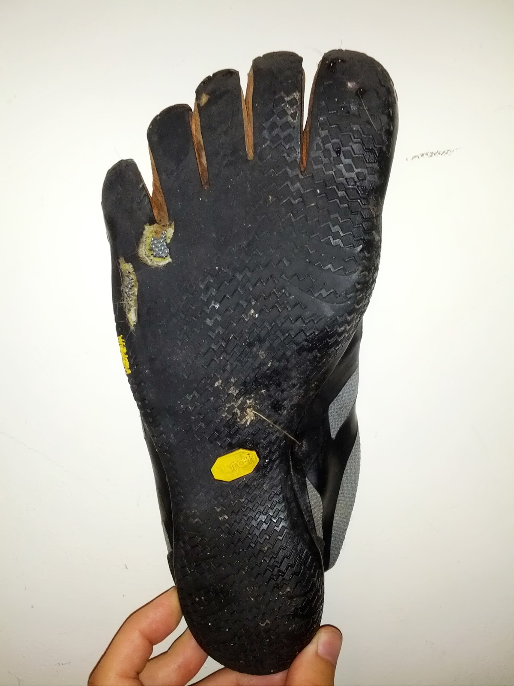
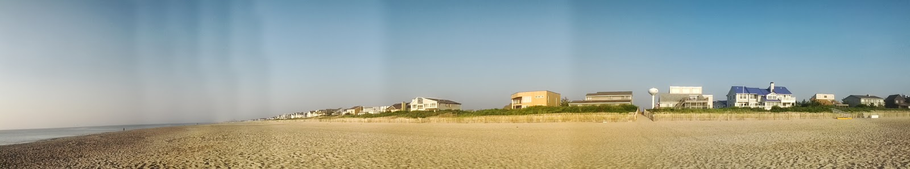

Although running is indeed one of the few sports that require very little equipment, one still cannot do without the basic essentials of clothing, which (in most cases) include a pair of sturdy running shoes. I've already [outlined](/blog/posts/my-one-year-runniversary/) the broad strokes of the debut of my running career, but talking solely about distances covered does not do the topic proper justice. Therefore, I will now turn to a (lengthy) discussion of the shoes that I have thus far appropriated for the purpose of taking me from point A to point A in my daily runs.

My first "running shoe" was the humble [Kirkland Court Classic](http://www.amazon.com/Kirkland-Signature-Court-Classic-Sneakers/dp/B004YQSK26/), which I had been using as my quotidian sneaker for quite some time. From July 10 to November 6, I ran 361 miles in my trusty Court Classic, including a [5K race](http://app.strava.com/activities/27703031) in September, but I was forced to retire the shoes when they developed holes in the soles. This wouldn't have been a huge problem, but Princeton was suddenly and unexpectedly showered with snow, which not only melted and seeped into my shoe but also packed into ice and stabbed my foot with every step towards the end of my evening run. The discomfort finally convinced me to visit [the local running store](http://www.run.com/store/princeton-running-company) and acquire a pair of "real" running shoes.

I didn't have a clue about what sort of running shoe I should purchase, aside from an endorsement of Mizuno as a good brand, so I just walked into the store and asked for help. A helpful employee had me run around a bit outside on the sidewalk, and she concluded that, due to my overpronation, I should look into stability shoes. She then brought out a few different pairs of shoes and had me try them on to see how they feel. Since I couldn't really notice any difference, I ended up getting the Mizuno specimen, which ended up being the [Mizuno Wave Inspire 8](http://www.amazon.com/Mizuno-Mens-Wave-Inspire-Running/dp/B005FWDU8M). The very next day, I ran a [5K race](http://app.strava.com/activities/27701520) in the new shoes, unaware at the time of the general consensus in the running community that running a race in brand new shoes is not such a good idea. Nevertheless, during the race, I quickly discovered the benefits of running in proper shoes, setting a PR of 21:32 that still stands today and having a blast in the process.

Over the next few months, I continued running in my Wave Inspire 8, picking up a second pair along the way and also a pair of its successor, the [Wave Inspire 9](http://www.amazon.com/Mizuno-Wave-Inspire-Running-Silver/dp/B008FHJC0E/). However, I also became interested in [minimalist running](http://www.reddit.com/r/barefootrunning) after being exposed to the concept on [the running subreddit](http://www.reddit.com/r/running), and in late December I used my birthday money to buy a pair of [Vibram KSO](http://www.amazon.com/Vibram-Fivefingers-Water-Shoes-Black-Black-Black/dp/B001JYIM1A/) from [my local REI store](http://www.rei.com/stores/baileys-crossroads.html). In January, I started adding a short run in my KSO right after my daily 10K distance in my Wave Inspire 8. I can see why this was a bad idea in retrospect, but at the time I thought I was killing two birds with one stone, simultaneously increasing my distance by a modest amount and beginning the transition to minimalist footwear. Unsurprisingly, this strategy backfired in a big way, causing me to develop moderately severe [top of foot pain](http://www.reddit.com/r/running/search?q=top+of+foot+pain&restrict_sr=on) in my right foot.

I stopped running in my KSO for a week and dramatically slowed my running pace, which helped, but then I also developed pain in the middle of my plantar fascia in the same foot, most likely from involuntarily altering my gait in order to lessen my top of foot pain. Stubbornly, I continued to run despite the discomfort, slowing my pace even more in the hope that the pain would eventually go away on its own and even brazenly sneaking in [a tremendously painful run](http://app.strava.com/activities/39301064) in my KSO. Although I was absolutely miserable by the end of that run, I was surprised to see that I felt a lot better in the next few days as a result of taking that risk. I then hypothesized that my initial problem had been the constant alternation between supportive and minimalist shoes, rather than the minimalist shoes themselves. I continued to run primarily in the Wave Inspire 8, but I also did a minimalist run roughly once a week in an effort to strengthen my feet.

In March, I decided to expand my minimalist arsenal when I did some searches online and saw that I could get a pair of [Vibram Bikila](http://www.amazon.com/Vibram-FiveFingers-Bikila-Light-Grey-Red-Grey/dp/B0087HSDFM/) for a solidly discounted price at [a local running store](http://www.casualadventure.com/). I [ran there](http://app.strava.com/activities/44045824) in my KSO, tried on the Bikila, and confidently walked out with a small box containing my acquisition. Excited, I stopped for a moment to swap shoes and then walked to the Metro in my new Bikila. My excitement was tempered somewhat when I actually [ran in them the next day](http://app.strava.com/activities/44147311), because they seemed stiff and not as comfortable as my KSO. Still, I was hopeful that they would loosen up with further use, and so I decided to keep them. In the meantime, I kept running in my Wave Inspire 8 and noticing that my foot pain was lessening with each run.

As my pain continued to disappear, I became more confident about running in minimalist shoes and visited REI for a pair of [Vibram EL-X](http://www.amazon.com/Vibram-FiveFingers-Mens-Black-Orange/dp/B00BCO88UC/), a new Five Finger model that I had read about online and that was advertised as the thinnest shoe produced by Vibram yet. The retail price was lower than that of all of Vibram's other offerings, and I was quickly impressed with just how much ground feel the shoe provided. I took the EL-X out for a spin and was pleasantly surprised to see that I could run [5.8 miles](http://app.strava.com/activities/47251751) in them quite comfortably. Just [a few days later](http://app.strava.com/activities/47940482), I bit the bullet and start running only in my EL-X. Although I immediately noticed that my pace was considerably slower, I found myself enjoying my runs more and decided that I don't care all that much about pace anyway. That same week, I ran [my first 5K in minimalist footwear](http://app.strava.com/activities/48624367), and I was reasonably satisfied with my performance given the minimalist "handicap" to which I had subjected myself.

The last runs I ever did in my Wave Inspire 8 were a [half marathon](http://app.strava.com/activities/50130396) and a [full marathon](http://app.strava.com/activities/50497364), since I wasn't confident enough that I could complete those distances in minimalist shoes. Those runs were a bit strange for me because I had become used to a forefoot / midfoot strike in my Vibrams, but running in that manner in those big, clunky shoes felt awkward. I ended up mostly heel-striking and keeping a slow pace, and I was glad to retire the Wave Inspire 8 once I finished. When I checked Strava, I found that I had covered 594 miles in my older pair and 395 in my newer pair (I had been alternating pairs to extend their longevity), which I figured wasn't too shabby given that the typical recommendation is to replace shoes after 300-500 miles. The retirement of my Wave Inspire 8 was a milestone moment for me because from that point onward, I wore my growing collection of Vibrams virtually exclusively, shunning ordinary shoes (and socks, for that matter).

My EL-X served me well, but they too had to be retired after a large hole developed in the sole of the right shoe between my pinkie toe and its neighbor. Still, I was impressed that such a (seemingly) flimsy shoe was able to take 523 miles of (ab)use before finally falling apart. Not wanting to run in anything else, I hastily went to REI to procure a replacement, and I ended up opting for a size 43 because the 44 I had been wearing seemed a bit too roomy. I suspected that my feet had subtly shrunk because my KSO also felt loose, even though when I first bought them they were perfectly snug. In fact, I ended up giving my KSO an early retirement, gifting them to my mom's (now ex-) boyfriend after having run only 43 miles in them because I was concerned my foot would move around too much and develop blisters. I wasn't too sad to part with them, since I liked the EL-X a lot more anyway. I still have my size 43 Bikila, but I've only put 41 total miles on them as a result of my appreciation for the EL-X.

The newest addition to my Five Finger collection is the [Vibram KSO Trek](http://birthdayshoes.com/vibram-five-fingers-kso-trek-review), which I snagged for a bargain-basement price thanks to Vibram's daft decision to discontinue this excellent shoe. I haven't run much in the KSO Trek thus far because I want to "save" them for occasions that truly require such a thick-soled shoe (by Five Finger standards). Counting [last week's epic trail runs in West Virginia](http://app.strava.com/activities/69217378), I have only put 21 miles on the KSO Trek. Of course, I have another two pairs stockpiled, since I know that they will be increasingly hard to find due to their discontinued production. One of my backup pairs now serves me as a general-purpose walking shoe, and I love every kangaroo leather-cushioned step.

One "shoe" that I haven't mentioned thus far isn't really a shoe at all – yes, I have run some miles completely barefoot as well. On my one-year runniversary, I ran [10K barefoot](http://app.strava.com/activities/66097162) on the concrete sidewalks of my usual route, earning myself only moderate discomfort in the process. Then, during my brief vacation in Bethany Beach, Delaware with my good friends from high school, I ran [8-ish miles](http://app.strava.com/activities/66976133) on the sandy beach every day, bringing my total barefoot mileage to 67. I definitely plan on doing more barefoot runs in the future, but I doubt that I will ever go completely unshod – I like my Five Finger shoes too much for that. My new EL-X have 108 miles on them so far, and I will definitely keep running in them until they fall apart like my old pair. I will probably have to invest in a pair of [Vibram Lontra](http://www.amazon.com/Vibram-Fivefingers-Lontra-Black-Grey/dp/B008B739I4/) for the winter, but I don't have to worry about that just yet.

--lbds137
