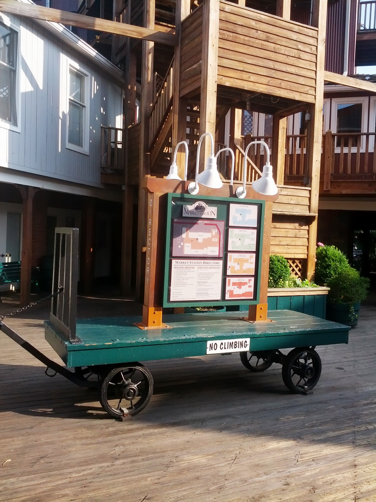
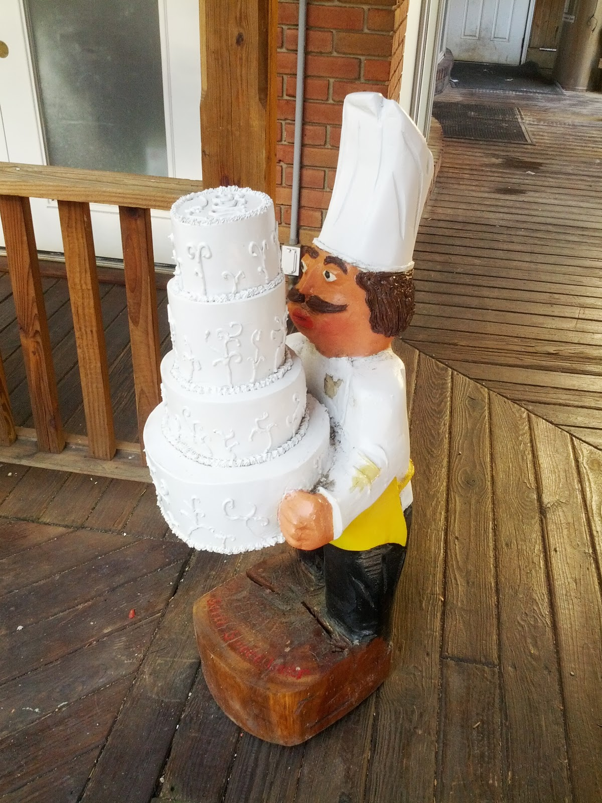
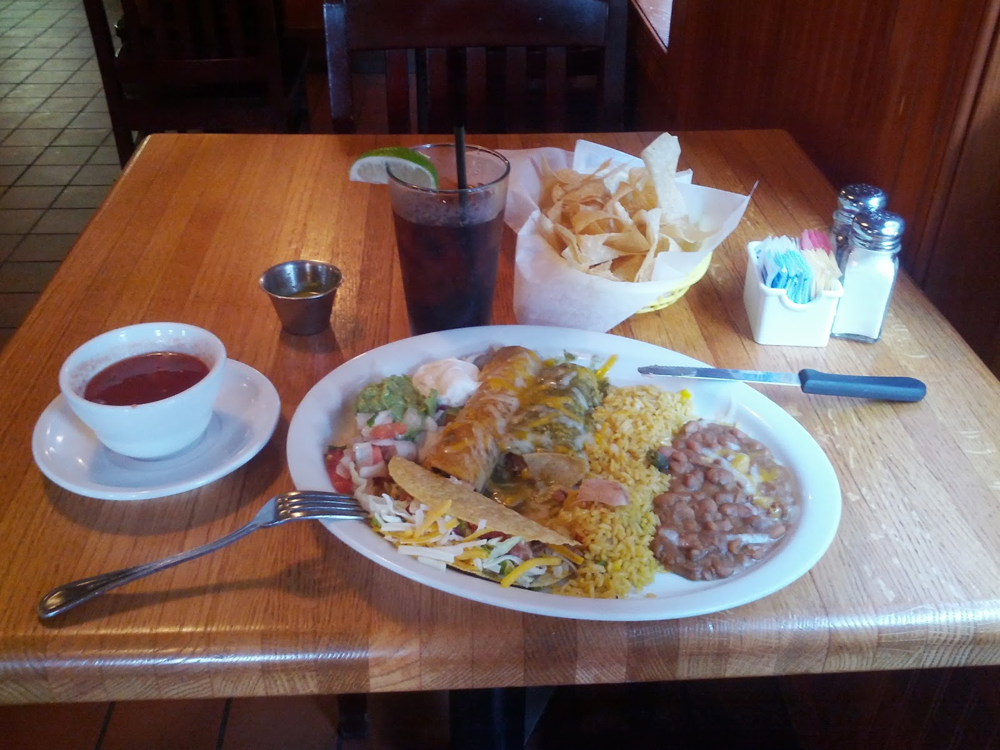
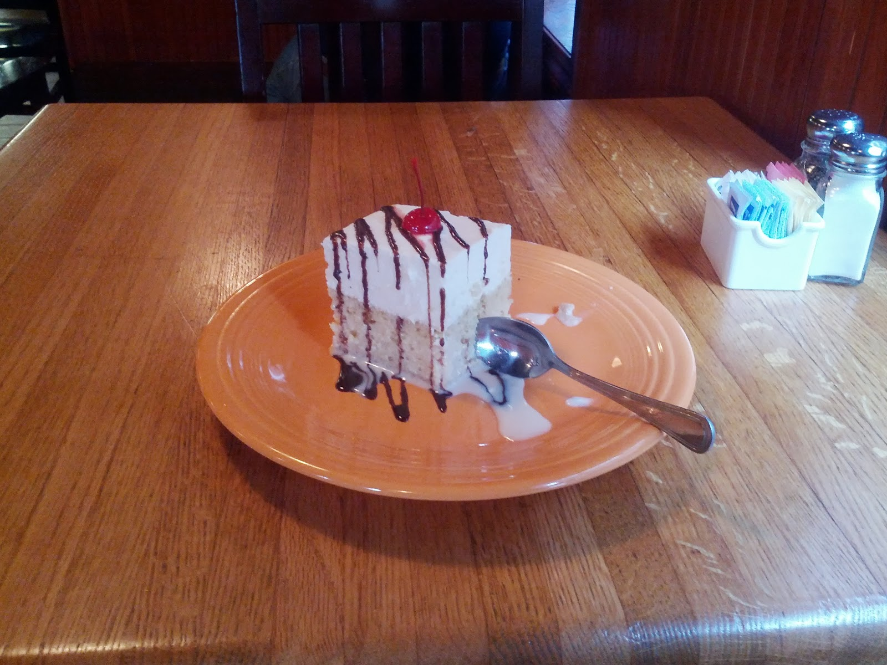

Today was the first day of Strava's [fi'zi:k Tour Tune-Up Challenge](http://app.strava.com/challenges/fizik-tour-tune-up), the completion of which requires participants to ride 30 hours on their bicycle of choice in the span of 16 days. When I joined the challenge, I did some simple math and found that 30 hours split across 16 days comes out to 1:52:30 per day. That's kind of a lot for a relative biking newbie like me – I got my Specialized Hardrock 17" bike from [Phoenix Bikes](http://www.phoenixbikes.org/) in Arlington back on [May 10th](http://app.strava.com/activities/53498064), and I've tried to cover at least a modest distance each day since then (with a couple of exceptions, of course). When I went out the door today about an hour after my daily [6.5 mile run](http://app.strava.com/activities/59049342), I had planned to ride for roughly 2 hours, in order to stay on track for the riding challenge. Instead, I ended up riding for almost 4 hours, split into two equal-sized pieces. For reference, my longest continuous ride before today was [almost 23 miles](http://app.strava.com/activities/57624413), which took me about 1.5 hours to complete.

At this point, you may be wondering "OK, he rode a lot today, but where the heck did he go?", which is a perfectly reasonable question. The title of this post provides a pretty solid hint – I [rode](http://app.strava.com/activities/59089422) to Leesburg, VA and [back](http://app.strava.com/activities/59115141). Why Leesburg? Well, the initial plan was for me to take the [W&OD trail](http://www.wodfriends.org/map1.html) to Reston, eat there, and come back, with an estimated transit time of just under 2 hours. Of course, when I actually got there, I assessed how I felt and decided that I could definitely keep going and get a leg up on the riding challenge. I was also curious about what I'd find along the trail west of Reston, so the spirit of exploration also had a hand in convincing me to keep going.

Aside from a few road crossings of varying difficulty (with regard to the amount of automobile traffic), the trail consisted mostly of shrubs, high bushes, houses on either side, open fields, wooded areas, some bridges over large creeks, and lots and lots of power lines (to be expected given [the trail's provenance](http://www.wodfriends.org/trail.html)). There were quite a few points of interest along the trail, most of which are listed on [the trail's Wikipedia page](http://en.wikipedia.org/wiki/Washington_%26_Old_Dominion_Railroad_Regional_Park) (I know I'm being lazy, but my excuse is that I'm tired after doing so much riding today). On my way to Leesburg, I passed through a laundry list of localities: Falls Church, Dunn Loring, Vienna, Reston, Herndon, Sterling, Ashburn, and of course Leesburg itself. When I finally reached Leesburg, I checked my phone to see how far I had gone, and I started looking for a place to eat when I saw that I had ridden almost 30 miles.

Although I couldn't see any restaurants from the intersection of the W&OD trail and Harrison Street, I pulled up Google Maps on my phone and saw that the center of Leesburg was just a stone's throw away, so I hopped back on my bike and turned right, following Harrison Street until I found a quaint wooden outdoor plaza called Market Station. Happy to find a wooden rack to chain my bike to, I started walking around the deck, keeping an eye out for restaurants as I went along. I passed by an Italian restaurant, whose miniature Italian-chef-holding-a-wedding-cake statue made me chuckle, and felt a rush of excitement when I saw a Tex Mex establishment called [Los Tios Grill](http://www.lostiosgrill.com/), deciding on the spot that I would dine there.

Once inside the restaurant, I hastily grabbed a menu and skimmed it, trying to assess the ratio of quantity to price of the various offerings. I ended up making my own combination of a delicious trio: one hard shell beef taco, one beef enchilada, and one chicken enchilada. After a bit of confusion on the waiter's part as to whether I'd be taking out or ordering in, I sat down at a table and hungrily awaited my meal. To the staff's credit, the food came out very quickly – a generous offering of chips and salsa was soon followed by an enormous platter of food. The taco and enchiladas were accompanied by rice, beans, guacamole, sour cream, diced tomatoes, and a small container of tasty spicy sauce. In a rare moment of foresight, I snapped a photo of the food, knowing that I'd probably want to write about it later, and commenced eating. Like the tornadoes that tore through Oklahoma recently, I swiftly and mercilessly laid waste to the food in front of me, scarfing it down in under 13 minutes (as indicated by the timestamps of the "before" and "after" photos).

Unfazed despite the mountain of food I had just consumed, I took the first opportunity to remind the waiter of my dessert order. He nodded and went on his way, and within a few minutes I was greeted by a large square chunk of ambrosial tres leches cake. As soon as I took the first bite, I knew that this cake would not last long, despite its impressive size, and sure enough the plate was empty in less than 4 minutes. Anxious to get home before dark, I asked for the check, leaving a large tip as thanks for the quick service, and rushed back to my bike.

The ride back home seemed quite a bit shorter than I had expected, even with a full stomach, and it turns out that I actually covered the distance at a slightly higher speed. Undoubtedly this was due to the occasional pedal-to-pedal skirmishes I engaged in against other bikers along the way, passing them and sometimes later being passed. One of the most intense "battles" I fought was against a woman on her road bike – she passed me somewhere in Vienna, but I stayed fairly close behind and overtook her on the fairly steep hill leading up to the bridge over I-66. After conquering the hill, I sped down along Virginia Lane and looked back, taking pride in the fact that my opponent was nowhere to be seen. From the Shreve Road intersection onward, the ride became a blur, and I was home before I knew it, well before it got too dark outside.

--lbds137
